# LeogotoPlay

`LeogotoPlay` 是一个视频工具 App 的双端工程：**iOS 版 + macOS 版**，共用一层端无关的 `LeogotoPlayCore`（Swift Package）。

两边都是同一套产品能力：

1. **素材库管理**：根目录直接导入 / 展示视频（与文件夹同一套列表 cell，含缩略图、名称.mp4、大小、添加日期、时长）→ 文件夹收纳（V1.0.3 支持多级子文件夹，V1.0.4 固定列表视图）→ 搜索 / 排序 / 移动 / 重命名 / 删除
2. **播放器**：进度拖动、倍速、循环、画面填充
3. **基础剪辑**：相簿 / 素材库视频 → 裁剪（时间轴双手柄）、静音 → 存回相簿或存入素材库，也可导出到用户指定的位置
4. **账号体系**：登录 / 注册 / 登录态持久化（本地演示实现，接口已抽象，方便接后端）

iOS 首页是 `Cut / List / Mine` 三个 Tab，结构由 `AppConfig` 驱动，可增删改序；macOS 用侧栏对应 `剪辑台 / 素材库 / 我的` 三个入口。

| iOS Cut | iOS List | iOS Mine |
| --- | --- | --- |
|  | 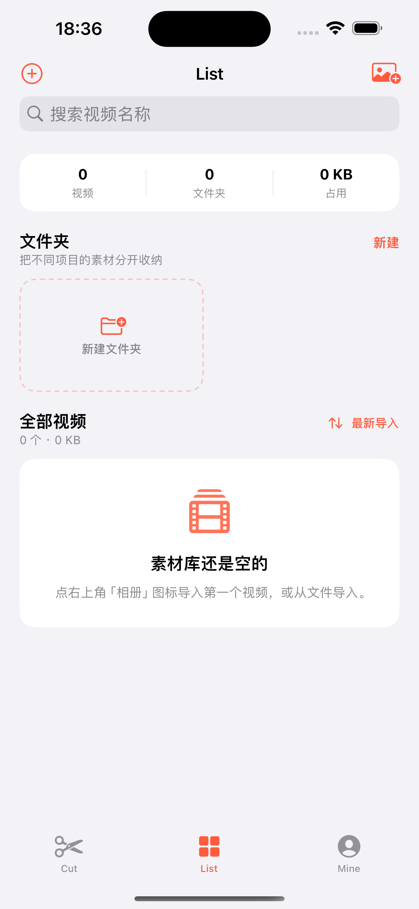 | 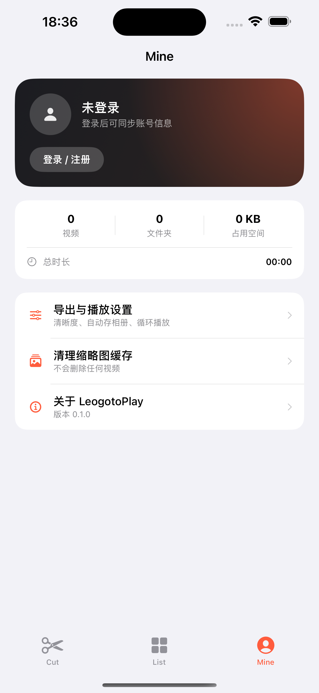 |

### V1.0.4 · List 页收敛

| 根目录（统计卡 = 视频 / 占用空间 / 总时长，点击进入全部视频） | 文件夹内（不显示统计卡） |
| --- | --- |
|  | 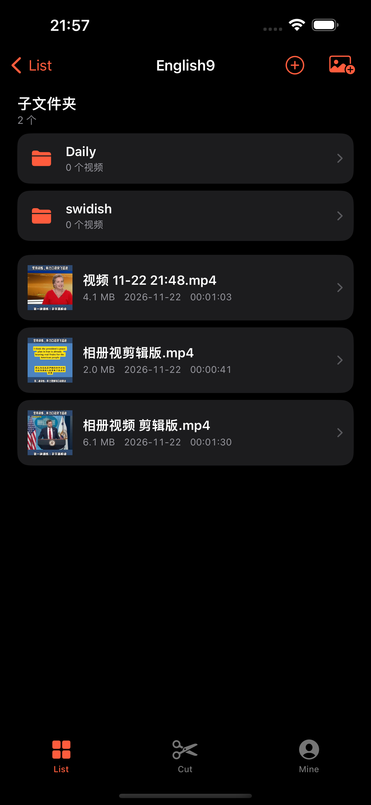 |

- 去掉文件夹区域的布局切换按钮（列表 / 卡片），固定列表展示；卡片视图代码一并移除。
- 去掉文件夹标题右侧的 `All` 入口。
- 统计卡从「视频 / 文件夹 / 占用」改为「视频 / 占用空间 / 总时长」，整块可点，点进去就是全部视频列表（原来 All 的去处）；卡片上不显示右指向箭头，点击提示只靠卡片本身。
- 文件夹内页不再显示统计卡，进目录直接看子文件夹与视频。
- 搜索时（关键词非空）首页也不显示统计卡，页面直接呈现「搜索结果」，避免搜索时还占着顶部统计的空间。

搜索态截图：`docs/screenshots/10-search-no-stats.png`。

### V2.6 · 锁按钮左移与滑杆按需浮现

| 默认：滑杆不显示，锁按钮在左侧 | 滑动左侧：浮出亮度滑杆 | 滑动右侧：浮出音量滑杆 |
| --- | --- | --- |
| 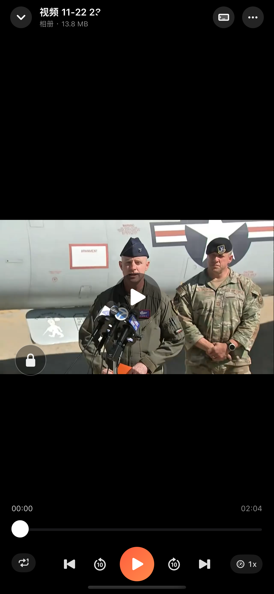 | 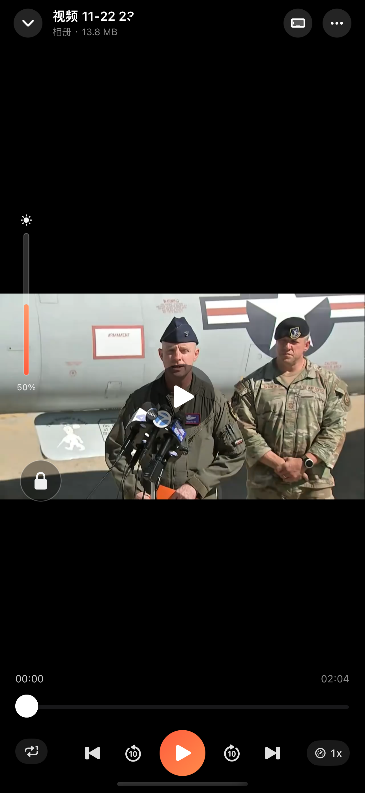 | 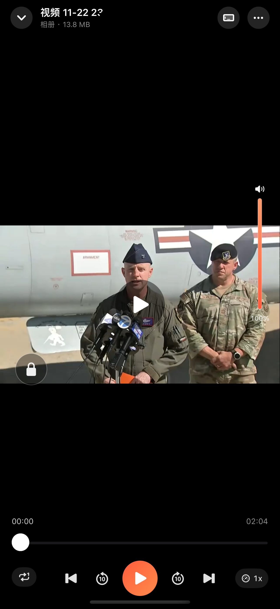 |

- 锁按钮从右侧音量滑杆下方挪到左侧、亮度滑杆下方。
- 亮度滑杆和音量滑杆默认完全不显示；只有手指在左 / 右两侧区域按下并滑动时才浮出来，松手 1 秒后自动消失。
- 两侧触控区大幅加宽（竖屏 96pt、横屏 132pt，竖直方向覆盖滑杆高度），不用瞄准那根 6pt 细条就能调；滑杆本身不可点击（`allowsHitTesting(false)`），只负责显示。
- 百分比数字常驻占位、只切透明度，浮现时滑杆长度不会跳。
- 顶栏整排（返回 / 标题 / 横屏 / 更多）整体下移到灵动岛下方：竖屏顶部留白 62pt、横屏 58pt（iPhone 15 Pro Max 安全区顶部 59pt、灵动岛占 11~48pt），标题和按钮不会再被灵动岛盖住。

### V2.5 · 锁定态控件的自动隐藏

| 锁按钮放大 1.5 倍并下移 | 锁定态：只留开锁按钮 + 进度条 | 锁屏 3 秒无操作后全部隐藏 |
| --- | --- | --- |
| 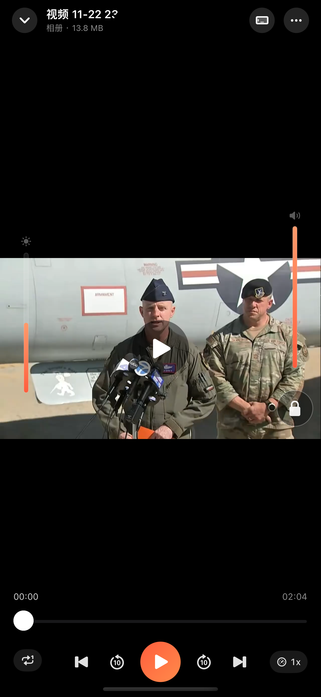 | 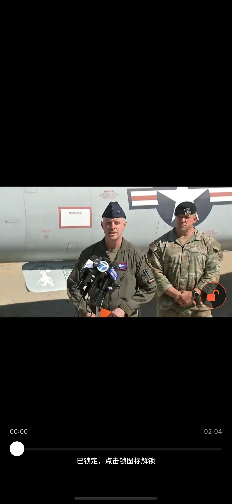 | 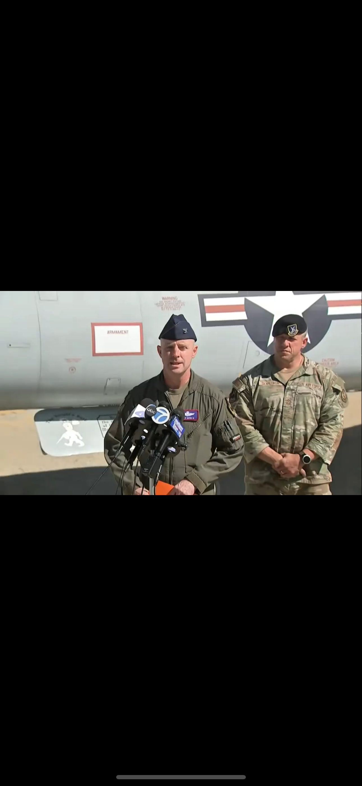 |

- 锁按钮从 32pt 放大到 48pt，并整体下移一点，更好按。
- 进入锁定状态后不再一直亮着：3 秒没有任何操作，锁按钮一起淡出；此时点一下屏幕，锁按钮重新出现并重新计时。
- 锁定态下进度条仍然显示但不可拖动（滑杆手势禁用、运输控件整排隐藏），同样 3 秒后随着锁按钮一起淡出，点屏幕再次唤回。
- 解锁后恢复正常控制层并重新开始 3 秒计时。

### V2.4 · 播放器全屏按钮常驻与锁定

| 音量滑杆下方的锁按钮 | 锁定态（只剩开锁按钮） | 横屏 3 秒后顶栏仍保留 |
| --- | --- | --- |
| 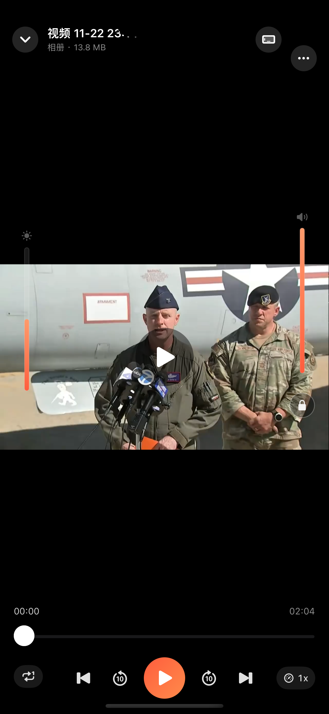 | 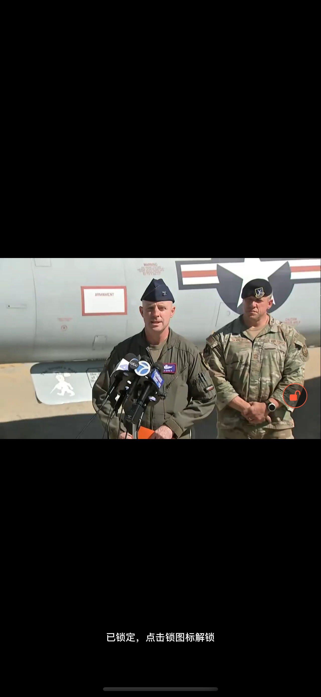 | 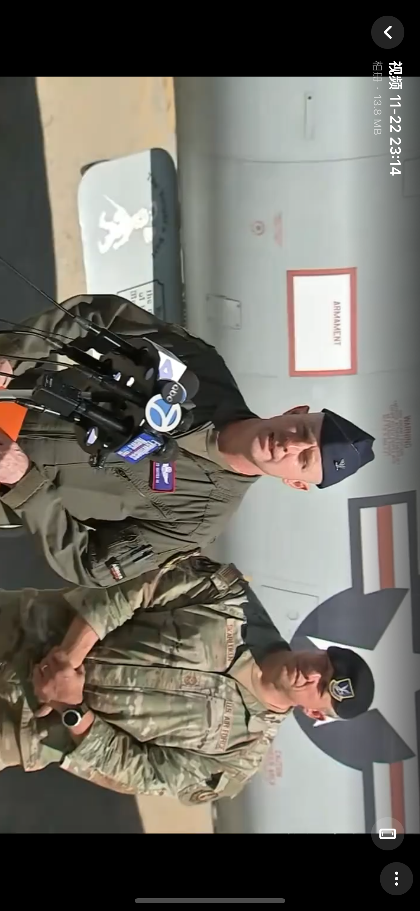 |

- 横屏（全屏）播放时不再自动收起顶栏：返回按钮和横屏按钮一直留着，点横屏按钮回到竖屏正常播放，点返回按钮直接退出视频；底栏进度与播放控制仍然 3 秒后自动隐藏。
- 横竖屏切换只切换布局分支：`onAppear` / `onDisappear` / `.task` 都挂在最外层，切换分支不会触发 `onDisappear` 把横屏状态清掉（修掉了「点一下横屏立刻弹回竖屏」）。
- 音量滑杆下方新增锁按钮（默认 `lock.fill`）：点一下变成开锁图标 `lock.open.fill` 并进入锁定状态——所有按钮、进度条、左右滑杆和画面点击手势全部失效，屏幕上只留这一个开锁按钮；再点它恢复成正常控制。
- 锁定时会飘一条「已锁定，点击锁图标解锁」提示，横屏下同样生效；V2.5 起锁定态的锁按钮与进度条也走 3 秒自动隐藏，详见下一节。

### V2.3 · 播放器画面与横屏 / 投屏

| 默认按原始比例（不裁切） | 横屏播放 | 投屏面板 |
| --- | --- | --- |
| 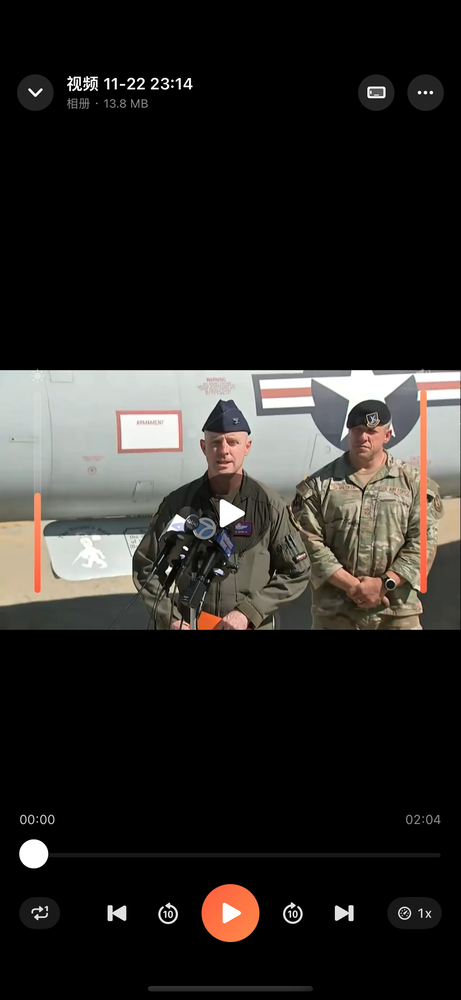 | 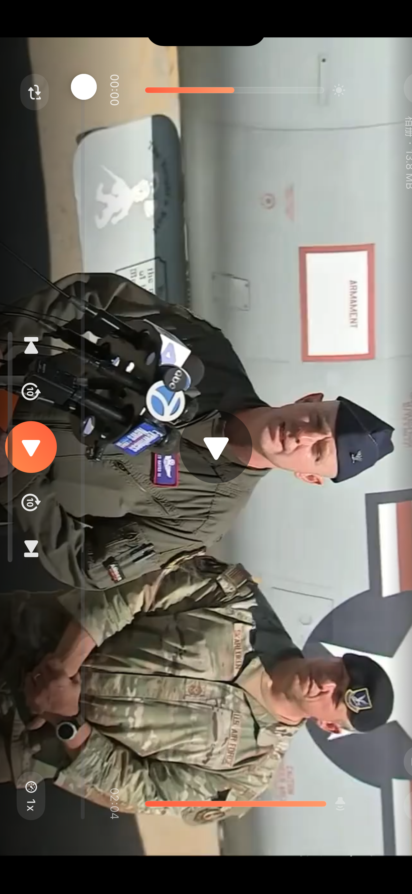 | 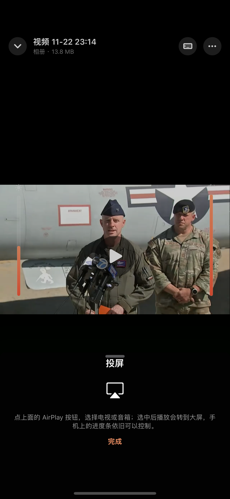 |

- 视频默认按原始宽高比完整显示（aspect fit，多出来的部分留黑边），不再默认裁切填满；需要填满时仍可从「⋯」里切到画面填充。
- 右上角「⋯」左边新增横屏按钮（`iphone.landscape` / `iphone` 图标切换），点一下把播放页转成横屏，再点回到竖屏；退出播放页时若仍是横屏会自动恢复竖屏。
- 「⋯」菜单新增「投屏」：弹出的面板里是系统 `AVRoutePickerView`（AirPlay 设备选择），选中后画面投到电视 / 音箱，手机上的进度条依旧可控。
- 横屏实现：播放页把整页旋转 90° 铺满横向画面（按 430×932 换算出 932×430 的横屏画布），不改设备方向，其它页面固定竖屏；左右滑杆在横屏下自动缩短，避免撑破横向布局。

### V2.2 · 播放器控制层

| 进入时全展示 | 3 秒无操作后自动隐藏 |
| --- | --- |
| 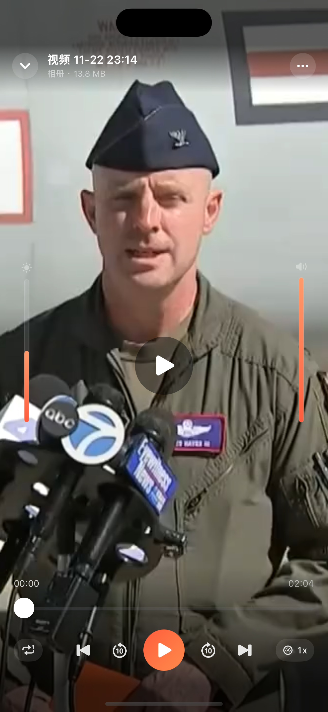 | 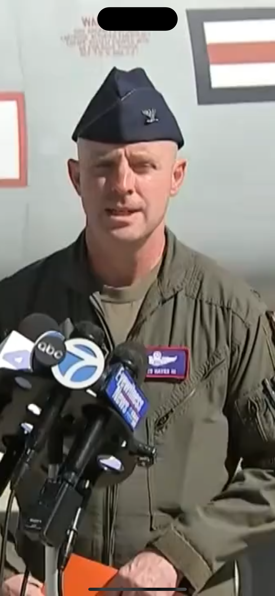 |

- 右上角收起为「⋯」更多：点开弹出底部操作面板，内含剪辑、画面填充/适应、投屏；实现上用 Button + `confirmationDialog` 而不是 `Menu`，因为 `Menu` 自带的图标内边距会让这个圆形按钮和左边的横屏按钮上下错位。
- 进播放页时控制层全部展示；3 秒无操作自动淡出（顶栏、底栏、左右滑杆一起隐藏）。点画面立刻隐藏，再点一次重新出现并重新计时；播放、拖动进度、切上下一个、改倍速/循环、拖亮度音量都会重置计时。
- 打开倍速面板期间不自动隐藏。

### V1.1.0 · 播放器

| 控制条（循环模式 · 上一个/±10s/播放/下一个 · 倍速） | 倍速滑块 |
| --- | --- |
|  | 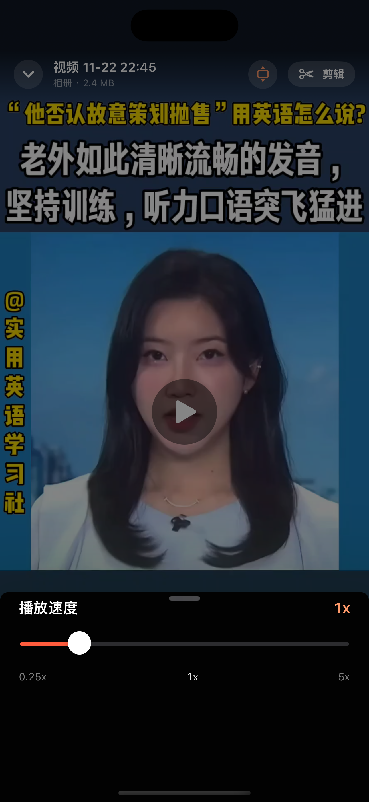 |

- 播放控制居中：上一个 / 倒退 10 秒 / 播放暂停 / 前进 10 秒 / 下一个，五个按钮同一排；「上一个 / 下一个」在同一个文件夹的视频队列里循环切换。
- 同排最左是循环模式菜单：单曲循环（默认）/ 文件夹循环 / 列表播放 / 单曲停止。
- 同排最右是倍速按钮，点开是 0.25x–5x 的滑块（步进 0.05），当前倍速在滑块标题和按钮上同步显示。
- 画面填充开关从底栏挪到顶栏（视频右上角圆形按钮），底栏位置让给三段式控制。
- 播放器左右两侧各有一条竖向滑杆：左侧亮度（`UIScreen.main.brightness`），右侧音量（`MPVolumeView` 写系统音量，取不到滑杆时退回 `AVPlayer.volume`）。在两侧区域上下拖动即调整，拖动时滑杆高亮并显示百分比，松手 1 秒后收起。

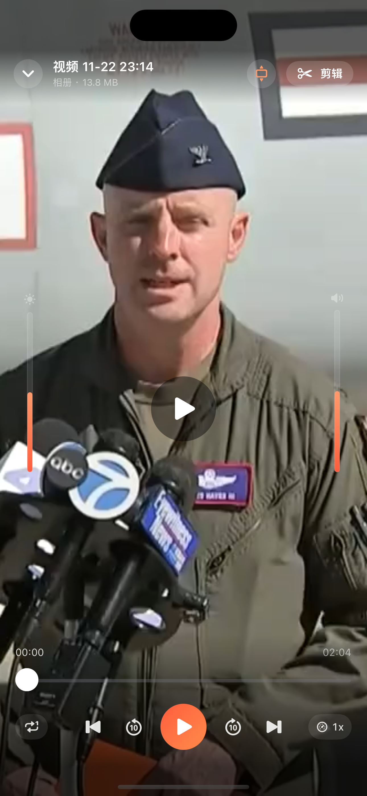

### V1.0.5 · 空态与标题

| 根目录（文件夹副标题 = 数量） | 有子文件夹、没有视频的目录（不显示空态） |
| --- | --- |
|  | 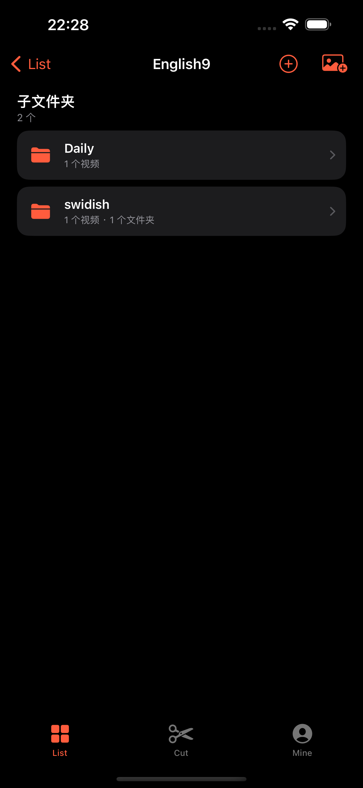 |

- 文件夹内页只有在「既没有视频、也没有子文件夹」时才显示 `这是个空文件夹`；已有子文件夹或视频就不再出现空态卡片。
- 首页「文件夹」分组副标题从说明文案改成数量，例如 `3 个文件夹`（按当前根目录下的文件夹数计）。
- 视频长按菜单里去掉了「收藏 / 取消收藏」两项，长按只剩 播放 / 剪辑 / 移动 / 重命名 / 删除。
- 文件夹内页去掉「子文件夹」小标题和 `N 个` 计数，子目录直接从顶部开始列。

早期版本截图（V1.0.3：`+` 建文件夹 / 相册导入，文件夹内 `+` 建子文件夹 / 添加视频）：`06-root-buttons.png`、`07-folder-add-video.png`；更早的 `04-list-plus.png`、`05-folder-subfolder.png` 里 `+` 与相册图标尚未交换、文件夹内还是操作菜单。

## 目录结构

一个仓库、两个 App 外壳、一个共享内核，用一个 workspace 把三者挂在一起：

```
Leogotocool/                       # 仓库根（本目录）
├── LeogotoPlay.xcworkspace        # 平时只需要打开这个
├── apps/
│   ├── ios/
│   │   ├── LeogotoPlay-iOS.xcodeproj
│   │   └── Sources/
│   │       ├── App/               # App 入口、RootTabView、AppConfig（Tab 配置）
│   │       ├── DesignSystem/      # Theme（颜色/字号）+ 通用组件
│   │       ├── Features/          # Cut / List / Mine / Player / Editor
│   │       └── Resources/         # Info.plist、Assets.xcassets
│   └── macos/
│       ├── LeogotoPlay-macOS.xcodeproj
│       └── Sources/
│           ├── App/               # @main、NavigationSplitView 宿主、菜单命令
│           ├── DesignSystem/      # MacTheme、MacComponents（卡片/空态/弹窗）
│           ├── Features/          # Root（侧栏）/ Cut / Library / Player / Editor / Mine
│           └── Resources/         # Info.plist
├── packages/
│   └── LeogotoPlayCore/           # 端无关逻辑，Swift Package
│       └── Sources/LeogotoPlayCore/
│           ├── Models/            # VideoItem、VideoFolder、UserAccount、AuthSession
│           ├── Store/             # LibraryStore、AuthStore（@MainActor，Combine）
│           └── Services/          # 文件存取、导入、导出、缩略图、Keychain、账号服务
├── docs/                          # ARCHITECTURE.md、截图
└── scripts/
    └── generate_xcodeproj.py      # 由文件列表生成两个 .xcodeproj + 一个 workspace
```

分层原则：**Core 只放端无关逻辑**（不 import UIKit / AppKit，不出现 `UIImage`/`NSImage`/`Color(uiColor:)`）；导航、播放画面、配色与系统集成留在各自 App 里。这样 iOS 和 macOS 只维护「壳」，业务逻辑改一次两端都生效。

## 运行

需要 Xcode 15.2+；部署目标 iOS 16.0 / macOS 13.0。

```bash
# 打开 workspace（推荐，一次加载两端 + 共享包）
open LeogotoPlay.xcworkspace
```

在 Xcode 里选择 scheme `LeogotoPlay-iOS` 或 `LeogotoPlay-macOS`，选好模拟器 / My Mac 后 `Cmd + R`。真机需要在 *Signing & Capabilities* 里指定自己的 Team（工程未写死 Team）。

命令行验证（本机已跑通）：

```bash
# iOS（模拟器）
DEVELOPER_DIR=/Applications/Xcode.app/Contents/Developer xcodebuild \
  -project apps/ios/LeogotoPlay-iOS.xcodeproj -scheme LeogotoPlay-iOS \
  -configuration Debug \
  -destination 'platform=iOS Simulator,name=iPhone 15 Pro Max' \
  -derivedDataPath build CODE_SIGNING_ALLOWED=NO build

# macOS（本机 run，ad-hoc 签名）
DEVELOPER_DIR=/Applications/Xcode.app/Contents/Developer xcodebuild \
  -project apps/macos/LeogotoPlay-macOS.xcodeproj -scheme LeogotoPlay-macOS \
  -configuration Debug -destination 'generic/platform=macOS' \
  -derivedDataPath build build

# 只校验共享包
cd packages/LeogotoPlayCore && swift build
```

> 若 `xcode-select -p` 指向 CommandLineTools，`xcodebuild` / `xcrun` 会找不到 SDK，命令前加 `DEVELOPER_DIR=/Applications/Xcode.app/Contents/Developer`。

**新增 / 删除源文件后必须重跑** `python3 scripts/generate_xcodeproj.py`，工程的编译清单是脚本按目录扫出来的，不重跑会报 “cannot find X in scope”。

## 调试入口

两端都留了只在 Debug 生效的直达钩子，方便截图和验证页面：

- iOS：启动参数 `-startTab cut|list|mine`，或深链 `leogotoplay://cut|list|mine`
- macOS：启动参数 `-startSection cut|library|mine`；`-autoOpenFirstVideo YES` 会自动打开最近视频的剪辑窗口

```bash
# macOS 直接打开剪辑窗口
open -a "$PWD/build/Build/Products/Debug/LeogotoPlay.app" \
  --args -startSection cut -autoOpenFirstVideo YES
```

## 数据与权限

- iOS 数据在 App 沙盒 `Documents/LeogotoPlay/`，macOS 在 `~/Library/Application Support/LeogotoPlay/`，都是 `Media/`（视频文件）+ `Thumbnails/`（封面）+ `library.json`（元数据）。
- 登录态存 Keychain，账号资料存本地 JSON；`AuthService` 是协议，换成真后端只改实现。
- 相簿读写需要 `NSPhotoLibraryUsageDescription` / `NSPhotoLibraryAddUsageDescription`（两端 Info.plist 已写）。

## Bundle 标识

| 端 | Bundle ID | 说明 |
| --- | --- | --- |
| iOS | `com.leogotoplay.app` | 深链 `leogotoplay://` |
| macOS | `com.leogotoplay.mac` | 本机 ad-hoc 签名，未沙盒 |
